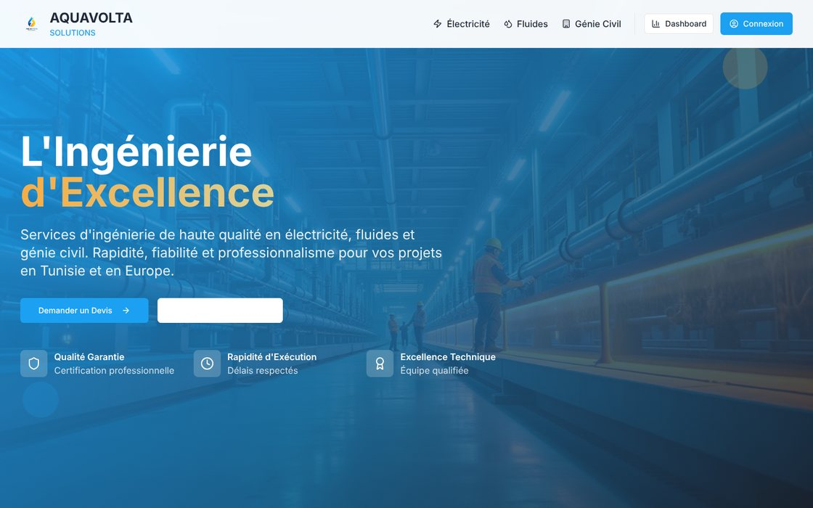
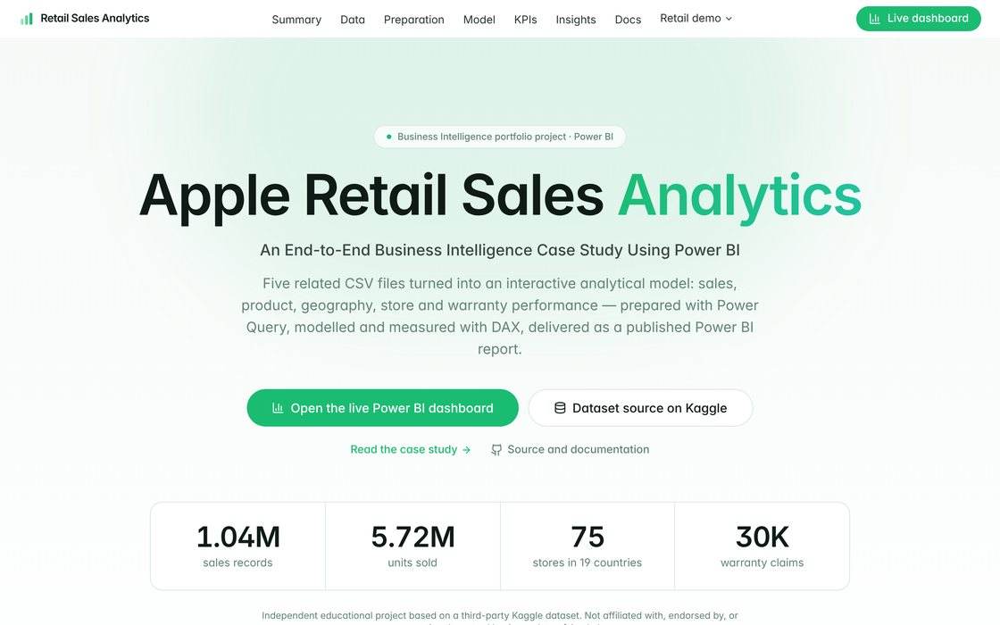
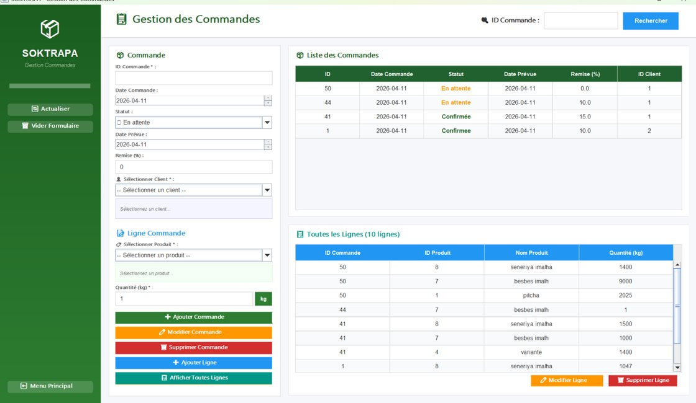

<picture>
  <source media="(max-width: 640px)" srcset="https://raw.githubusercontent.com/Edambi12/Edambi12/main/assets/hero/hero-mobile.svg">
  
</picture>

[About](#about) &nbsp;·&nbsp; [Projects](#projects) &nbsp;·&nbsp; [Stack](#stack) &nbsp;·&nbsp; [Certifications](#certifications) &nbsp;·&nbsp; [Recognition](#recognition) &nbsp;·&nbsp; [Education](#education) &nbsp;·&nbsp; [Contact](#contact)

## About

I'm a Business Computing student specialising in Business Intelligence at ISGIS, University of Sfax, currently on an Erasmus+ exchange at Lublin University of Technology in Poland.

I work on the part of BI that sits between the raw file and the finished report: cleaning source data, designing the warehouse model, writing the measures, and documenting what the numbers can and cannot say.

> **Open to a 2027 end-of-studies internship (PFE)** in Business Intelligence or Data Engineering, remote or on-site.

<picture>
  <source media="(max-width: 640px)" srcset="https://raw.githubusercontent.com/Edambi12/Edambi12/main/assets/diagrams/pipeline-mobile.svg">
  
</picture>

- **Business Intelligence and analytics.** Power BI reports, DAX measures and KPI definitions a decision-maker can trace back to the data.
- **Data engineering and ETL.** Staging areas, warehouse loads and dimensional models.
- **Data analytics and machine learning.** Profiling, cleaning and imputation in Python, with scikit-learn for exploratory modelling.

## Projects

### [AquaVolta BI Platform](https://github.com/Edambi12/aquavolta-bi-platform)

BUSINESS INTELLIGENCE · DATA ENGINEERING

Financial analysis for an engineering-services company, built on two years of revenue, expense, payroll and collections data. Excel sources are profiled and cleaned in Python, loaded with Talend into a MySQL staging area and data warehouse, and reported in a four-page Power BI report embedded in a web application.

The repository also holds a calculation audit that found and corrected an imputation error, and an exploratory scikit-learn study whose negative result is reported as such.

`Python` `Pandas` `scikit-learn` `Talend` `MySQL` `Power BI` `GitHub Actions`

**[View repository →](https://github.com/Edambi12/aquavolta-bi-platform)**

 

### [Apple Retail Sales Analytics](https://github.com/Edambi12/apple-sales-bi-platform)

BUSINESS INTELLIGENCE · DATA ANALYTICS

Five CSV files turned into one Power BI model: 1.04 million sales rows, 75 stores in 19 countries and 30,000 warranty claims. Data is typed in Power Query, measured in DAX with documented KPI definitions, and published as a three-page report with a case-study web application.

Built on a synthetic Kaggle dataset; the data quality notes and limitations are part of the repository.

`Power BI` `DAX` `Power Query` `Data Modeling`

**[View repository →](https://github.com/Edambi12/apple-sales-bi-platform)** &nbsp;·&nbsp; [Live report](https://app.powerbi.com/view?r=eyJrIjoiNjNjZTE3ZmUtNzAzNC00ODA3LWJkMGMtYWQ4MTNlYTUzNGE1IiwidCI6ImRiZDY2NjRkLTRlYjktNDZlYi05OWQ4LTVjNDNiYTE1M2M2MSIsImMiOjl9) &nbsp;·&nbsp; [Web application](https://apple-demo.lovable.app)

 

### [Sales Management Information System](https://github.com/Edambi12/sales-management-information-system)

SOFTWARE DEVELOPMENT · DATABASE DESIGN

Desktop application written during an internship at an agri-food company in Sfax. It follows the full sales cycle: customers, orders, stock control, invoices, payments and returns, replacing a process that ran on paper and spreadsheets.

Java Swing over a ten-table MySQL schema, with transactional JDBC access and 24 UML diagrams covering use cases, sequences and classes.

`Java` `Swing` `JDBC` `MySQL` `UML`

**[View repository →](https://github.com/Edambi12/sales-management-information-system)**

 

## Stack

<table>
  <tr><td><b>Business Intelligence</b></td><td><code>Power BI</code> <code>DAX</code> <code>Power Query</code> <code>Microsoft Fabric</code> <code>Dimensional Modeling</code> <code>Data Warehousing</code></td></tr>
  <tr><td><b>Data Engineering</b></td><td><code>ETL Pipelines</code> <code>Talend</code> <code>Microsoft Fabric</code> <code>Data Integration</code></td></tr>
  <tr><td><b>Programming &amp; Analytics</b></td><td><code>Python</code> <code>Pandas</code> <code>scikit-learn</code> <code>SQL</code> <code>Java</code> <code>C</code></td></tr>
  <tr><td><b>Databases</b></td><td><code>MySQL</code> <code>PostgreSQL</code> <code>Oracle PL/SQL</code></td></tr>
  <tr><td><b>Development Tools</b></td><td><code>Git</code> <code>GitHub</code> <code>Docker</code></td></tr>
</table>

## Certifications

<table>
  <tr>
    <td align="center" width="33%"> <b>PL-300</b> Power BI Data Analyst Associate Microsoft Certified</td>
    <td align="center" width="33%"> <b>DP-700</b> Fabric Data Engineer Associate Microsoft Certified</td>
    <td align="center" width="33%"> <b>AI-102</b> Azure AI Engineer Associate Microsoft Certified</td>
  </tr>
</table>

Also: **Google Data Analytics Professional Certificate**, and NVIDIA courses in Deep Learning and Data Science.

## Recognition

<table>
  <tr>
    <td align="center" width="33%"> <b>1st place</b> Green Up Sfax Hackathon 2026</td>
    <td align="center" width="33%"> <b>1st place</b> Hackathon Sabat Sfax &nbsp;</td>
    <td align="center" width="33%"> <b>1st place</b> Young Entrepreneur Hackathon JCI Gremda / IOM Tunisia</td>
  </tr>
</table>

National Student Entrepreneur Status, Innovator level, University of Sfax (2025–2026).

## Education

<table>
  <tr><td><b>2027</b> (expected)</td><td><b>Bachelor's degree in Business Computing, Business Intelligence</b> Higher Institute of Industrial Management of Sfax (ISGIS), University of Sfax, Tunisia</td></tr>
  <tr><td><b>Current</b></td><td><b>Erasmus+ KA171 mobility</b> Lublin University of Technology, Poland</td></tr>
</table>

Languages: Arabic (native), French, English.

## Contact

**[LinkedIn](https://www.linkedin.com/in/edam-ketata/)** &nbsp;·&nbsp; **[edam.ketata.bi@gmail.com](mailto:edam.ketata.bi@gmail.com)** &nbsp;·&nbsp; **[GitHub](https://github.com/Edambi12)**

Sfax, Tunisia · currently in Lublin, Poland

